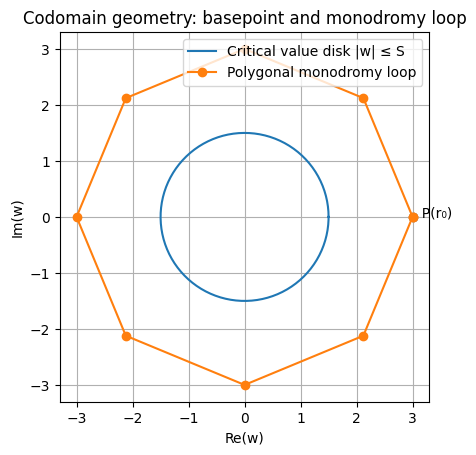
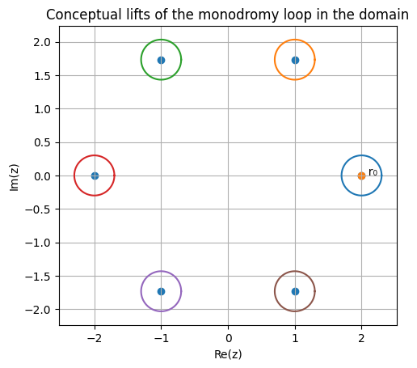

# Fibers and Monodromy Transport

Polynomial non constant maps 
```math
P\colon \mathbb{C}\to mathbb{C}
```
define branched coverings of the complex plane.  
For a value `w ∈ ℂ` that is not a critical value of `P`, the fiber
```math
P⁻¹(w) = \{ x ∈ ℂ : P(x) = w \}
```
onsists of exactly `deg(P)` points counted without multiplicity.

The goal of this section is to describe how `PolynomialCovers.jl`
computes such fibers and how they can be transported along paths
in the codomain using numerical path lifting.

---

## Mathematical Background

Let `P` be a polynomial of degree `d`.

Critical points are the solutions of
```math
P’(x) = 0
```
and the corresponding **critical values** are
```math
\{ P(x) : P’(x) = 0 \}.
```
Away from these values, the polynomial map behaves locally like a
covering map of degree `d`.

Therefore, for any regular value `w` the fiber contains exactly `d`
distinct points.

Furthermore, if `γ` is a path in the codomain that avoids the
critical values, each point of the fiber can be continued uniquely
along `γ`. This is the classical **path lifting property** of
covering maps.

---

## Representation of Fibers

A fiber is represented by the structure `Fiber`.

A Fiber object contains:
	•	the polynomial cover P,
	•	the list of preimages xs,
	•	the base value w,
	•	a radius bound S enclosing all critical values.

The structure is mutable because the fiber points are updated
when transported along paths.

⸻

Fiber Construction by Monodromy

To compute a fiber numerically, the package uses a monodromy
construction.

The idea is the following.
	1.	Choose a basepoint w₀ outside the disk containing all
critical values.
	2.	Compute one preimage x₀ such that P(x₀) = w₀.
	3.	Construct a loop in the codomain that surrounds the
critical value disk.
	4.	Lift this loop starting from x₀.

Each time the loop is lifted, the endpoint may land on a
different sheet of the covering. By repeating this process
and collecting the endpoints, all sheets of the fiber can
be discovered.

This procedure continues until deg(P) distinct points
have been found.

## API
```@docs
Fiber
```
The function fiber returns a Fiber object containing the
complete set of preimages.

⸻

## Path Lifting and Fiber Transport

Once a fiber is known at a basepoint w, it can be transported
along any path in the codomain that avoids the critical values.

If
```math
γ : [0,1] \to  \mathbb{C}
```
then there exists a unique lifted path
```math
x(t)
```
satisfying
```math
P(x(t))=γ(t)
```
Applying this lifting process independently to each sheet of
the fiber yields the transported fiber at the endpoint γ(1).

## API
```@docs
transport!
transport_to!
```
The function transport! lifts a path simultaneously for all
points of the fiber. The implementation can run either in
serial mode or in parallel using Julia threads.

The convenience function transport_to! automatically constructs
a safe path between two codomain values and transports the fiber
along it.

⸻

## Solving Polynomial Equations by Cyclic Lifting

A direct application of fiber transport is solving equations of the form
```math
P(x)=y
```
he solver proceeds in two stages:
	1.	compute a base fiber at a safe basepoint,
	2.	transport the fiber to the target value y.

Because the sheets are transported continuously, the resulting
roots inherit a natural cyclic ordering determined by the
monodromy action of the polynomial cover.

## API
```@docs
cyclic_lift_solver
```
This method is particularly useful for studying the global
structure of polynomial roots and for exploring monodromy
actions.

⸻

Algorithmic Summary

The workflow implemented in PolynomialCovers.jl can be
summarized as follows:
	1.	Compute bounds enclosing all critical values.
	2.	Select a basepoint outside this region.
	3.	Construct a loop around the critical value disk.
	4.	Use monodromy lifting to discover all sheets of the fiber.
	5.	Transport the fiber along paths to solve equations or
explore the covering.

This approach provides a robust numerical framework for
working with polynomial coverings and their monodromy.

---
## Monodromy Interpretation

The algorithms implemented in `PolynomialCovers.jl` have a natural
interpretation in terms of the **monodromy of polynomial coverings**.

Let
```math
P\colon \mathbb{C}\to \mathbb{C}
```
be a polynomial of degree `d`, and let
```math
C = \{ w ∈ ℂ : w = P(x) for some x with P’(x) = 0 \}
```
be the set of critical values of `P`.

The restriction
```math
P\colon \mathbb{C}\setminus P^{-1}(C)\to \mathbb{C}\setminus C
```
is a **topological covering map of degree `d`**.  
Consequently, any loop in the codomain that avoids the critical values
induces a permutation of the `d` sheets of the covering.

More precisely, if
```math
\gamma \colon [0,1]\to \mathbb{C}\setminus C
```
is a loop based at `w₀`, then lifting `γ` starting from a point
```math
x_0 \in  P⁻¹(w_0)
```
produces another point in the same fiber. Repeating this for each sheet
defines a permutation
```math
σ_γ : P⁻¹(w₀) \to P⁻¹(w₀).
```
he collection of all such permutations forms the **monodromy group**
of the polynomial cover.

---

### Numerical Monodromy

The function `fiber` exploits this structure numerically.

Starting from a single sheet `x₀`, the algorithm repeatedly lifts a loop
that surrounds the disk containing all critical values. Each lift may
land on a different sheet of the covering, revealing a new element of
the fiber.

By iterating this process, the orbit of the initial sheet under the
monodromy action is explored until all `d` sheets have been discovered.

This approach avoids the need for global root-finding methods and instead
relies on the topological structure of the covering.

---

### Cyclic Ordering of the Fiber

When the basepoint lies outside a large disk containing the critical
values, the behavior of the polynomial at infinity dominates:
```math
P(z) ≈ a_0 z^d
```
for large `|z|`.

In this regime, the `d` sheets of the fiber are arranged approximately
as the `d` roots of a complex number, forming a cyclic configuration
around the origin.

Transporting the fiber along paths preserves this cyclic structure,
which explains why the solver `cyclic_lift_solver` returns the roots
in cyclic order.

---

### Relation to Classical Theory

The numerical algorithms implemented in this package mirror classical
results from algebraic topology and complex analysis:

- the path lifting property of covering maps,
- the monodromy action of the fundamental group,
- the cyclic structure of polynomial coverings near infinity.

In this sense, `PolynomialCovers.jl` provides a computational framework
for exploring the monodromy of polynomial maps through numerical
path lifting.

## Monodromy Geometry

The fiber computation relies on lifting a loop in the codomain that
surrounds the disk containing the critical values.



The loop starts at the basepoint `P(r₀)` and avoids the critical
value disk of radius `S`.

---

## Lifted Paths in the Domain

Each sheet of the fiber lifts the loop independently in the domain.



Starting from the base point `r₀`, repeated lifts reveal all sheets
of the covering.


